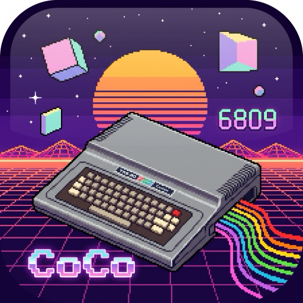
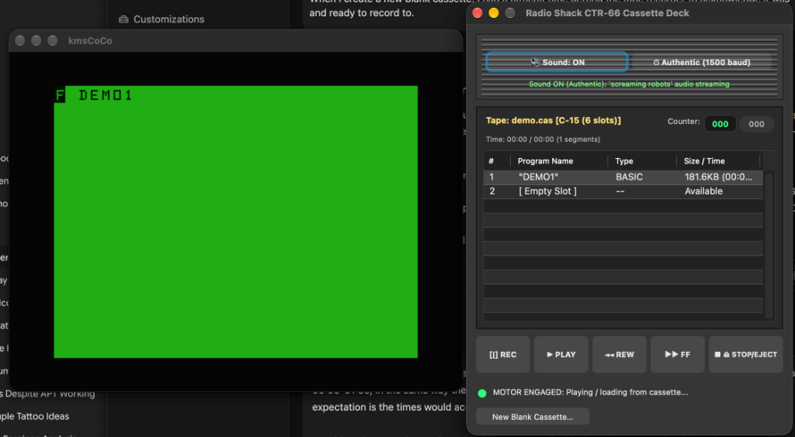

# kmsCoCo User Guide



Welcome to **kmsCoCo**, a high-fidelity, cross-platform emulator for the **Tandy Color Computer 1, 2, and 3**, the **Dragon 32/64**, and the **Tandy MC-10**. 

kmsCoCo combines cycle-accurate Motorola 6809/6801 and Hitachi 6309 CPU emulation with modern macOS desktop integration, including authentic composite video artifacting, virtual line printing with PDF export, high-speed clipboard pasting, and a specialized **Retro Cassette Deck** interface.

---

## Table of Contents

1. [Quick Start](#1-quick-start)
2. [Configuring ROMs & Preferences](#2-configuring-roms--preferences)
3. [The Retro Cassette Deck](#3-the-retro-cassette-deck)
   - [Authentic Speed vs. Turbo Speed](#authentic-speed-vs-turbo-speed)
   - [Screaming Robot Audio Monitoring](#screaming-robot-audio-monitoring)
   - [Cassette Well & Program Index](#cassette-well--program-index)
   - [Loading and Saving Programs](#loading-and-saving-programs)
   - [Overwriting and Deleting Recordings](#overwriting-and-deleting-recordings)
   - [Creating Blank Tapes](#creating-blank-tapes)
4. [Floppy Disk Emulation](#4-floppy-disk-emulation)
   - [Supported Disk Image Formats](#supported-disk-image-formats)
   - [Mounting and Ejecting Disks](#mounting-and-ejecting-disks)
   - [CoCoSDC Compatibility & Differences](#cocosdc-compatibility--differences)
5. [Text Entry & Auto-Typing](#5-text-entry--auto-typing)
   - [Paste from Clipboard (`Cmd+V`)](#paste-from-clipboard-cmdv)
   - [Type Text File into BASIC (`Cmd+Shift+T`)](#type-text-file-into-basic-cmdshiftt)
6. [Virtual Line Printing & PDF Export](#6-virtual-line-printing--pdf-export)
7. [Display, CRT, & Composite Artifacts](#7-display-crt--composite-artifacts)
8. [Keyboard Mapping & Shortcuts](#8-keyboard-mapping--shortcuts)
9. [Troubleshooting & FAQ](#9-troubleshooting--faq)

---

## 1. Quick Start

### Installation
On macOS, double-click **kmsCoCo.app** in `/Applications`.

### System Requirements
* **Operating System**: macOS 11.0 (Big Sur) or later (Apple Silicon M1/M2/M3/M4 and Intel x86_64).
* **Display**: Standard or Retina display with Metal/OpenGL support.
* **Audio**: CoreAudio compatible sound output.

### First Launch
When kmsCoCo starts, it searches standard ROM paths for Color BASIC and Extended Color BASIC ROM images. If ROMs are present, the familiar green 32x16 text screen appears with the banner:

```text
OK
```

---

## 2. Configuring ROMs & Preferences

Select **kmsCoCo > Preferences…** (or press `Cmd+,`) to open the settings panel.


### Preferred Media Folders
You can set default directory paths for your media collections:
* **ROMs Folder**: Location of system ROMs (`bas10.rom`, `extbas11.rom`, `disk11.rom`, etc.).
* **Cartridges Folder**: Default directory for `.ccc` / `.rom` cartridge images.
* **Floppy Disks Folder**: Default directory for `.dsk`, `.dmk`, and `.vdk` disk images.
* **Cassettes Folder**: Default directory for `.cas`, `.k7`, and `.wav` cassette tapes.

All file dialogs (including the Retro Cassette Deck and Disk menus) automatically open in your configured preferred folders.

---

## 3. The Retro Cassette Deck

kmsCoCo features an analog-style desktop cassette recorder and player interface accessible from **File > Cassette > Retro Cassette Deck…** or by pressing `Cmd+K`.



The deck simulates physical cassette mechanics:
* Chunky push-button transport keys (**REC**, **PLAY**, **REWIND**, **FAST-FORWARD**, **STOP/EJECT**).
* Mechanical 3-digit tape counter with zero reset.
* Visual tape cassette well with a segmented index table.
* Simulated cassette motor relay coupling (toggled by the Color Computer during `CLOAD` / `CSAVE`).

### Authentic Speed vs. Turbo Speed
Use the left button in the upper speaker section to toggle tape speeds:
* **Authentic Speed (`⏱ Authentic Speed`)**: Runs the tape transport at true 1500-baud physical tape speed. Loading a program takes the exact real-world duration it took on physical cassette media in the 1980s.
* **Turbo Speed (`⚡ Turbo Speed`)**: Bypasses physical timing delays, transferring tape data into memory in a fraction of a second.

### Screaming Robot Audio Monitoring
When running at **Authentic Speed**, you can toggle the **Sound** button (`🔊 Sound: ON` / `🔇 Sound: OFF`).
* When **Sound is ON**, kmsCoCo streams synthesized 1500-baud FSK (Frequency-Shift Keying) audio to your speakers during tape operations:
  > `"Sound ON: streaming 1500 baud 'screaming robot' audio during CLOAD."`
* Hearing this authentic audio feedback evokes the classic experience of listening to cassette loading with television audio turned up or monitor headphones connected!
* When speed is set to **Turbo Speed**, the Sound button is automatically disabled because data transfers instantaneously without audio synthesis.

### Cassette Well & Program Index
The index table lists all recorded programs residing on the cassette tape:
* **#**: Track / segment number.
* **Program Name**: Name stored in the tape header block (e.g. `"DEMO1"`).
* **Type**: File type detected (`BASIC`, `DATA`, or `ML (BIN)`).
* **Time**: Start and stop runtime recorded on the cassette (e.g., `00:00 - 01:25`).
* **Status**: Cued position indicator (`Active ▶`, `Cued ◀`, or `Ready`).

Clicking any row cues the tape directly to that recording. Double-clicking a row immediately cues and arms the tape player for loading.

### Loading and Saving Programs
1. Open the Retro Cassette Deck (`Cmd+K`).
2. Insert a cassette file (`.cas`) or create a new blank tape.
3. In Color BASIC, type:
   ```basic
   CLOAD "PROGNAME"
   ```
   *(or simply `CLOAD` to load the next available program)*.
4. Press **PLAY** on the cassette deck (if not already armed).
5. The Color Computer clicks its cassette motor relay, the cassette deck's **MOTOR ENGAGED** green indicator illuminates, and the tape loads into memory.
6. When loading completes, `OK` appears on the screen.

To save a program:
1. In Color BASIC, type:
   ```basic
   CSAVE "PROGNAME"
   ```
2. Press **[|] REC** on the cassette deck.
3. The motor engages, records the program data, and flushes the new block to the cassette file.

### Overwriting and Deleting Recordings
Right-click on any row in the cassette index table:
* **Overwrite Recording**: Records a replacement program directly over the selected slot while keeping preceding and following recordings intact.
* **Delete Recording**: Removes the selected program from the cassette tape and cleanly splices surrounding segments together.
* **Cue to Recording**: Fast-forwards or rewinds the tape directly to the start of the selected program.

### Creating Blank Tapes
Click **New Blank Cassette…** (or select **File > Cassette > New Blank Cassette…**).
You can choose standard tape lengths:
* **C-15**: 15 minutes of tape capacity (up to 6 recording slots).
* **C-30**: 30 minutes of tape capacity (up to 12 recording slots).
* **C-60**: 60 minutes of tape capacity (up to 20 recording slots).

---

## 4. Floppy Disk Emulation

kmsCoCo provides 4 virtual floppy disk drives supporting double-density 5.25" and 3.5" disk formats.

### Supported Disk Image Formats
* **`.DSK` / `.JVC` (Raw Sector Images)**: Standard raw linear sector images (35-track, 40-track, single- or double-sided). This is the universal standard format used by emulator communities and modern hardware like the CoCoSDC.
* **`.DMK` (David M. Keil Track Format)**: Raw track container preserving IDAM headers, CRC fields, inter-sector gaps, and mixed-density formatting.
* **`.VDK`**: Format created for Paul Burgin's PC-Dragon emulator with an informative 12-byte metadata header.

### Mounting and Ejecting Disks
* Select **File > Drive 1 > Insert disk…** (or press `Cmd+1`) to mount a disk in Drive 1.
* Drive shortcuts `Cmd+1` through `Cmd+4` mount disks to Drives 1 through 4.
* To save changes, disks are updated in real time or written back on ejection.

### Creating New Floppy Disks
Select **File > Drive 1 > New disk…** (or press `Cmd+Shift+1`):
* **Default Format**: kmsCoCo defaults to `.dsk` (`NewDisk.dsk`), ensuring 100% plug-and-play compatibility with CoCoSDC and FPGA devices like CoCo3_MiSTer. You can also specify `.dmk` or `.vdk` in the file name if desired.
* **Automatic Formatting Option**: The save dialog provides a convenient checkbox:
  > `[x] Automatically format disk for immediate use (Color BASIC / RS-DOS)`
  * **When Checked (Recommended)**: kmsCoCo creates the disk with 35 tracks, 18 sectors per track, 256 bytes per sector, and automatically writes a clean RS-DOS Directory and File Allocation Table (FAT) on Track 17. You can immediately use `DIR`, `SAVE "PROG"`, or write files without typing `DSKINI0`.
  * **When Unchecked**: An unformatted disk image is created. You can format it manually in Disk Extended BASIC by typing `DSKINI0`.

### CoCoSDC Compatibility & Differences
A common question among CoCo enthusiasts is why `.DSK` files work on the CoCoSDC hardware while `.DMK` images do not:
* **`.DSK`** stores pure data sector payloads (`35 tracks × 18 sectors × 256 bytes = 161,280 bytes`). The CoCoSDC microcontroller maps floppy controller sector-read requests directly to logical sector offsets (`LBA = track × 18 + sector`) on the SD card's FAT filesystem.
* **`.DMK`** stores the complete low-level disk flux track structure (including 128-byte IDAM pointer tables, sync bytes `$A1`/`$C2`, address marks, CRC polynomials, and gaps). The CoCoSDC firmware does not decode raw FM/MFM flux containers.
* **Best Practice**: Use `.DSK` for universal compatibility across kmsCoCo, CoCoSDC, and FPGA platforms like CoCo3_MiSTer.

---

## 5. Text Entry & Auto-Typing

Writing or debugging BASIC programs in modern text editors and importing them into the emulator is seamless in kmsCoCo.

### Paste from Clipboard (`Cmd+V`)
You can copy BASIC code or commands directly from any macOS text editor, browser, or IDE and press **`Cmd+V`**.
* kmsCoCo injects text directly into Color BASIC via the ROM keyboard vector (`POLCAT`).
* Line feeds (`\n`) and carriage returns (`\r`) are automatically normalized.
* Authentic CPU timing is strictly maintained without skipping characters or locking the CPU in turbo mode.

### Type Text File into BASIC (`Cmd+Shift+T`)
Select **File > Type Text File into BASIC…** (or press `Cmd+Shift+T`).
* Choose any `.bas`, `.txt`, or `.asc` file on your Mac.
* kmsCoCo streams the file into the Color Computer prompt character-by-character, exactly as if typed by an ultra-fast keyboard operator!

---

## 6. Virtual Line Printing & PDF Export

kmsCoCo includes a built-in virtual printer simulating the Tandy Line Printer VII / DMP-100 series connected to the CoCo's serial/bit-banger port.

When running BASIC commands such as:
```basic
LLIST
LPRINT "HELLO FROM COLOR BASIC"
```

The print controller captures printer output and handles it according to your preferences in **kmsCoCo > Preferences…**:
* **Print Destination**:
  * **System Print Prompt**: Opens the standard macOS print dialog for printing to physical printers or generating high-resolution PDFs.
  * **Save to Directory**: Automatically creates numbered text or PDF files in your preferred folder.
* **Page Styling**:
  * Customizable font family (Courier, Monospaced, Serif, Sans-Serif).
  * Configurable font size and page margins.
  * Running headers with optional document title and timestamp.
  * Automatic pagination with configurable page numbers (e.g. *Page 1 of 3*).
  * Configurable auto-flush timer (flushes buffered lines when the printer is idle).

---

## 7. Display, CRT, & Composite Artifacts

The Tandy Color Computer's Motorola 6847 Video Display Generator (VDG) produces distinct artifact colors when displayed over NTSC composite monitors:
* **Composite Colors (NTSC Artifacting)**: Select **View > TV input > Composite** to enable red/blue color artifacting in high-resolution graphics modes (`PMODE 4`).
* **RGB Mode**: Select **View > TV input > RGB** for sharp, crisp digital pixels.
* **Picture Sizing**: Switch between Authentic 4:3 CRT aspect ratio and full-frame rendering under **View > Picture area**.

---

## 8. Keyboard Mapping & Shortcuts

### Main Menu Shortcuts

| Shortcut | Action | Description |
|---|---|---|
| `Cmd+,` | Preferences | Open kmsCoCo configuration settings |
| `Cmd+K` | Retro Cassette Deck | Open the Retro Cassette Deck interface |
| `Cmd+1` | Insert Disk 1 | Mount floppy disk in Drive 1 |
| `Cmd+2` | Insert Disk 2 | Mount floppy disk in Drive 2 |
| `Cmd+3` | Insert Disk 3 | Mount floppy disk in Drive 3 |
| `Cmd+4` | Insert Disk 4 | Mount floppy disk in Drive 4 |
| `Cmd+V` | Paste Text | Paste text from clipboard into BASIC prompt |
| `Cmd+Shift+T` | Type File | Stream a `.bas`/`.txt` file into BASIC |
| `Cmd+R` | Soft Reset | Reset CPU while preserving RAM contents |
| `Cmd+Shift+R` | Hard Reset | Full power-cycle reboot of the Color Computer |
| `Cmd+Q` | Quit | Gracefully shutdown kmsCoCo |

### Color Computer Key Equivalents

| Mac Key | Color Computer Key | Notes |
|---|---|---|
| `Delete` / `Backspace` | `←` (Left Arrow) | Backspace in Color BASIC |
| `Escape` | `BREAK` | Halts running BASIC program |
| `Enter` / `Return` | `ENTER` | Executes command |
| `Up Arrow` | `↑` | Cursor up |
| `Down Arrow` | `↓` | Cursor down |
| `Left Arrow` | `←` | Cursor left |
| `Right Arrow` | `→` | Cursor right |
| `F1` | `CLEAR` | Screen clear |

---

## 9. Troubleshooting & FAQ

### 1. I see "OK" but my cassette load hangs on `F FILENAME`
* Ensure the **Retro Cassette Deck** has **PLAY** armed.
* If the motor relay clicks and stops, verify that the audio monitor or authentic speed is selected and the counter is progressing.
* If loading a multi-segment tape, make sure the tape is cued to the correct segment in the index table.

### 2. Can I use disks formatted on a real Color Computer?
* Yes! Raw sector images (`.DSK`) dumped from real 35-track or 40-track floppies via tools like CoCoSDC or DriveWire work directly in kmsCoCo.

### 3. How do I configure ROM files if the screen is black?
* Open **Preferences** (`Cmd+,`), navigate to the **ROMs** section, and choose the directory where your Color Computer ROMs (`bas10.rom`, `extbas11.rom`, `disk11.rom`) are stored. kmsCoCo scans and binds them automatically.
